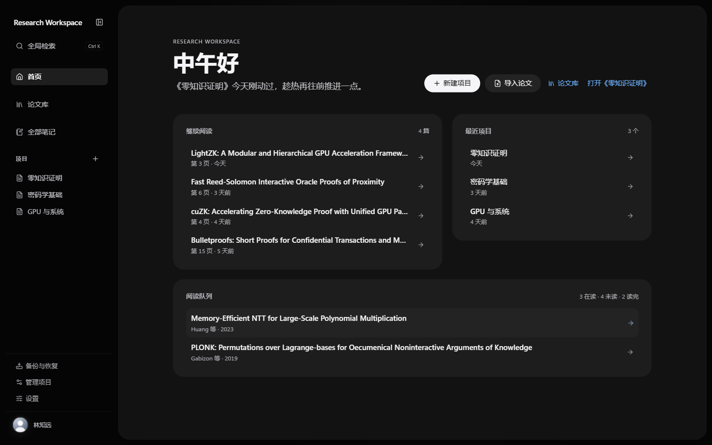
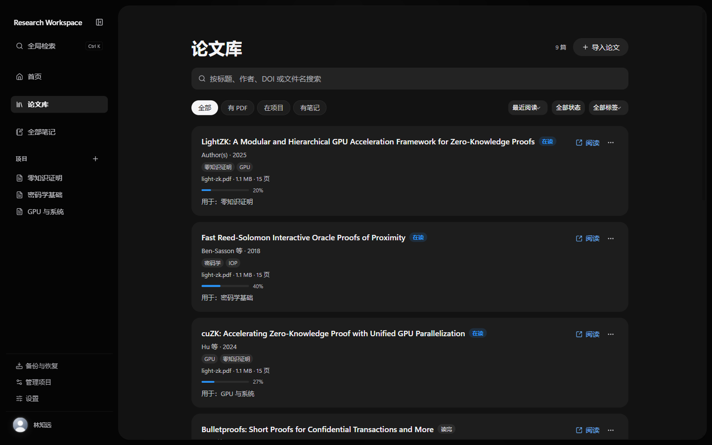
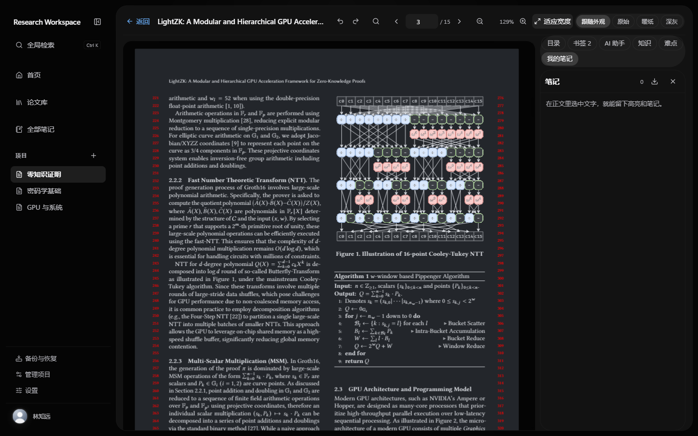

# Research Workspace

面向论文精读的本地优先研究工作台：把 PDF 阅读、笔记、书签、知识关系与可核验的 AI 解读放在同一个桌面应用里。

所有数据默认留在本机；AI 能力默认运行在离线的模拟提供方上，只有你显式配置并切换后才会调用在线模型。



| 论文库                                                        | 阅读器                                                       |
| ------------------------------------------------------------- | ------------------------------------------------------------ |
|  |  |

> 截图中的论文、项目与摘录均为测试数据。

## 功能

- **论文库**：导入 PDF、编辑元数据、按标题/作者/年份/阅读进度排序与筛选、处理重复文件、跨库搜索。
- **阅读器**：PDF.js 渲染、翻页与缩放、适应宽度、目录、书签、选段高亮与笔记、阅读队列；侧栏与阅读面板可以拖动调宽，窄窗口下自动变为浮层。
- **AI 精读**：对选中段落提问、翻译、解释公式与概念；回答中的引用必须逐字来自本次发送的原文，否则不会显示为可点击引用。
- **知识库**：概念、概念关系、学习前置关系、证据与候选；把笔记和原文引用挂到概念上，并能跳回论文对应位置。
- **全局笔记与搜索**：跨论文查看、检索笔记与标注，快速回到原文。
- **本地优先**：项目、笔记、标注与设置保存在本机；PDF 字节存放在 IndexedDB；支持导出/恢复备份。
- **桌面体验**：Tauri 2 打包为 Windows 安装包，支持浅色/深色/纯黑主题与窄窗口布局。

## 技术栈

| 层           | 技术                                                              |
| ------------ | ----------------------------------------------------------------- |
| 前端         | React 19、TypeScript 6、Vite 8、PDF.js 6、KaTeX、lucide-react     |
| 本地 AI 服务 | Node.js（`server/`，原生 `http`，无框架）                         |
| 桌面壳       | Tauri 2、Rust、NSIS                                               |
| 测试与质量   | Vitest、Testing Library、ESLint、Prettier、Playwright（验收脚本） |

## 架构

```text
┌──────────────────────────────┐
│ React 前端（src/）            │
│  阅读器 / 论文库 / 知识库 …   │
└───────┬──────────────┬───────┘
        │ HTTP         │ Tauri IPC
        │ 127.0.0.1    │
┌───────▼──────────┐ ┌─▼────────────────────────┐
│ AI sidecar       │ │ Rust 壳（src-tauri/）      │
│ server/*.mjs     │ │  窗口 / 凭据 / 子进程生命周期 │
└───────┬──────────┘ └─┬────────────────────────┘
        │              │
        ▼              ▼
  mock 或在线模型    系统凭据存储
```

- 前端只发送结构化请求（论文、页码、段落、问题），提示词由 sidecar 组装。
- 桌面版启动时由 Rust 拉起 sidecar：绑定临时端口、每次启动生成随机 Bearer 令牌、清理父进程环境变量，并通过 stdin EOF 与 PID 看门狗退出。
- 浏览器开发时，Vite 把 `/api/ai` 代理到本机 `8787`，页面保持同源。

## 快速开始

### 环境要求

- Node.js **22.13+**
- 桌面开发/打包额外需要：Rust stable 工具链、WebView2 Runtime、Tauri 的 Windows 构建依赖
- Windows 安装包使用 NSIS

### 浏览器开发

```bash
npm install
npm run ai:serve   # 终端 1：本地 AI 服务（默认离线模拟）
npm run dev        # 终端 2：http://127.0.0.1:1440
```

### 桌面开发

```bash
npm run desktop:dev
```

该命令会先把 Node 运行时与服务代码复制为 sidecar（`rw-node.exe`），再启动 Tauri。

### 构建安装包

```bash
npm run desktop:build
```

产物位于 `src-tauri/target/release/bundle/nsis/`。安装包按当前用户安装，并内置 WebView2 引导程序。

### 质量门禁

```bash
npm run check   # 类型检查 + ESLint + Prettier + 全部测试
```

## AI 配置与密钥处理

### 默认离线

不配置任何环境变量时使用 **mock provider**：不联网、不计费。应用启动本身不会发起在线调用。

### 浏览器开发时连接在线模型

需要同时设置提供方与密钥，缺一不可：

```powershell
# PowerShell
$env:AI_PROVIDER='deepseek'; $env:AI_API_KEY='sk-…'; npm run ai:serve
```

```bash
# bash / Git Bash / macOS / Linux
AI_PROVIDER=deepseek AI_API_KEY=sk-… npm run ai:serve
```

`AI_PROVIDER` 可选 `deepseek` / `openai` / `moonshot` / `zhipu` / `dashscope` / `custom`，
配合 `AI_BASE_URL` 与 `AI_MODEL` 指向任何 OpenAI 兼容端点（本机服务可用
`http://127.0.0.1:…`，其余必须 https）。旧的 `DEEPSEEK_*` 变量仍然兼容。

### 桌面版

在 **设置 → AI 服务** 中选择供应商，API 地址与模型名称都可以手动填写，
也可以先保存密钥再点“获取可用模型”，由 Rust 通过 `GET {API 地址}/models` 读取该账号
实际可用的模型列表。保存后会重启 sidecar。

Key 按供应商分别写入系统凭据存储（Windows Credential Manager），前端之后只能读到
“这个供应商是否已配置”，没有任何接口可以取回明文。

思考强度只对 DeepSeek 显示（`none` / `low` / `high` / `max`）；其他供应商按标准
OpenAI 兼容协议发送请求，不携带 DeepSeek 专有字段。设置页还可以配置请求数、
单次 token 与会话 token 预算。

### 安全边界

- **仓库不包含任何真实 API Key。** 源码与测试里出现的 `sk-…` 均为占位符或测试用假值。
- Key 不进入 LocalStorage、IndexedDB、普通 JSON 配置、备份文件、URL、命令行参数或日志。
- sidecar 只监听 `127.0.0.1`，端口不可配置为对外地址；校验 `Host` 与 `Origin`，限制请求体大小、频率与并发。
- 系统提示词由服务端组装，论文原文只作为数据块出现在 `user` 消息中。
- 引用逐字校验：段落 id 必须属于本次请求，引文必须是该段落逐字子串；不合格的引用会被丢弃并计数。

> 如果你 fork 或部署这个项目：不要提交 `.env`。一旦怀疑密钥泄露，请立即在模型提供方控制台**吊销并重新生成**，再更新本机配置。

## 数据与备份

- 项目、笔记、标注和界面设置保存在浏览器/WebView 的 LocalStorage。
- PDF 原始字节保存在 IndexedDB。
- 备份与恢复在应用内完成；恢复前会展示将发生的变化。
- 卸载应用不会自动删除 WebView 数据目录；需要彻底清理时请手动删除对应应用数据目录。

## 目录结构

```text
src/                 React 前端（features / domain / services / styles）
server/              本地 AI sidecar（mock、在线提供方、引用校验、预算）
src-tauri/           Tauri 壳、凭据存储与 sidecar 生命周期
scripts/desktop/     桌面 sidecar 准备脚本
scripts/verify/      端到端验收脚本
docs/                分阶段验收报告与截图
public/              静态资源
```

## 贡献

欢迎提交 Issue 与 Pull Request。提交前请先运行：

```bash
npm run check
```

请勿在 Issue、日志或提交中包含真实 API Key、论文全文或个人信息。

## 许可

[MIT](LICENSE)
